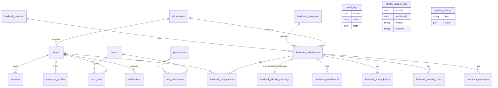

# Feed — Architecture & Implementation Plan (Phase 1)

> **Current model (updated 26 Nov 2026): employees never sign in.** Every submission is fully anonymous, made from the public pages `/` → `/submit` and followed up at `/track` with a reference and a one-time secret key. No identity is stored, so the earlier "Super Admin reveals identity" feature was **removed**. Only HR, reviewers and Super Admins have accounts. Older sections below that mention employee login, "My submissions" or identity reveal describe the previous design.

## Stack (free, self-hosted, no cloud)
| Layer | Choice |
|---|---|
| App | Next.js 15 (App Router, Route Handlers), TypeScript |
| UI | **shadcn/ui** components (Radix primitives). Tailwind is only shadcn's internal styling engine — no hand-written utility soup; all UI comes from `src/components/ui` + composed components |
| Font / look | **Inter**, dark-first zinc palette with teal accent (matches the supplied CRM screenshot: left sidebar, section groups, tabbed settings, bordered cards, dashed empty states) |
| Motion | Framer Motion, honours `prefers-reduced-motion` |
| Icons | lucide-react |
| DB | PostgreSQL run from npm (`embedded-postgres`, no Docker), port 55432, data at `./storage/postgres` |
| ORM | Prisma + versioned migrations |
| Auth | Own session auth: bcrypt hashes, HttpOnly/SameSite=Strict/Secure cookies, DB-backed sessions (revocable), TOTP MFA (otplib) mandatory for Super Admin |
| Validation | Zod on every route handler |
| Charts | Recharts |
| Files | **Local disk** `./storage/uploads`, AES-256-GCM encrypted, random UUID names, metadata stripped (sharp for images; PDFs re-saved) |
| PWA | Web manifest, installable, service worker (static assets + offline page only — never caches API/feedback data), mobile-first layouts, bottom nav on phones |
| Tests | Vitest (unit/integration), Playwright (E2E, mobile + desktop projects) |

## Roles & permission matrix
| Permission | Super Admin | HR | Reviewer | Employee |
|---|:-:|:-:|:-:|:-:|
| Submit / track own feedback | – | – | – | ✔ |
| View all feedback content | ✔ | ✔ | assigned/dept only | own only |
| Assign / status change | ✔ (override) | ✔ | progress only | – |
| Internal notes | ✔ | ✔ | ✔ (assigned) | – |
| Reply to submitter | ✔ | ✔ | ✔ (assigned) | ✔ (own) |
| Reveal identity (reason + MFA re-check, audited) | ✔ | ✘ | ✘ | ✘ |
| Identity access audit | ✔ | ✘ | ✘ | ✘ |
| Manage users/depts/categories/settings | ✔ | – | – | – |
| Reports / export (never identity) | ✔ | ✔ | own dept | – |

Deny-by-default: every handler calls `requirePermission(session, 'perm')`; no permission → 404 (not 403) to avoid existence leaks.

## Identity separation
- `feedback_submissions` has **no** user FK. It carries only a random `reference` (e.g. `FB-7K3Q-9XMD-P2WA`, 60+ bits, CSPRNG).
- `feedback_identity_mappings(feedback_id, encrypted_user_id, iv, tag)` — AES-256-GCM, key from env, only readable via `identityService.reveal()`, which:
  1. checks SUPER_ADMIN role + fresh MFA (≤5 min),
  2. requires a reason (≥20 chars),
  3. writes `identity_access_logs` in the same transaction (append-only; DB trigger blocks UPDATE/DELETE).
- Employee "my submissions" lookup uses a separate keyed HMAC index (`owner_hmac = HMAC(user_id, key)`) so the employee can list their own cases without a plaintext join.
- Postgres RLS + a separate DB role for the identity table as defence-in-depth.
- Timestamps shown to HR are rounded to the day; no IP/UA stored on submissions.
- Notifications/emails contain only reference + status, never content or names.

## Data model (Prisma)
users, roles, permissions, user_roles, departments, employee_profiles, sessions,
feedback_categories, feedback_priorities, feedback_submissions, feedback_identity_mappings,
feedback_attachments, feedback_assignments, feedback_status_history, feedback_internal_notes,
feedback_messages, notifications, audit_logs, identity_access_logs, system_settings.

## Workflow
Submitted → Received → Under Review → Assigned → Investigation → Action Required → Resolved → Closed,
plus Rejected (reason), Duplicate, Escalated, Awaiting Info. Transitions enforced by a state table; each writes `feedback_status_history`.

## Screens
Employee: login, dashboard, submit (stepper), success, my submissions, detail + messages, profile/security.
HR: dashboard, inbox (filters), assigned, investigation detail, notes, resolution, reports.
Super Admin: overview, all feedback, detail, identity management, identity audit, employees, departments, HR, reviewers, categories, reports, notifications, system config, security.

## Phases
1. ✔ Plan + scaffold (this doc, Next.js, shadcn, PWA, local Postgres without Docker)
2. ✔ App shell (sidebar, mobile bottom nav), Prisma schema + hardening migration, auth + MFA, RBAC, identity service
3. ✔ Feedback APIs, workflow, messages, attachments (metadata stripped, encrypted)
4. ✔ Dashboards, reports (CSV/PDF), admin management, notifications, accounts
5. ✔ Tests: 42 unit + 40 e2e (identity-leak suite, RBAC, security, workflow, UI on desktop + mobile)
6. ✔ Encrypted backups with verified restore, security audit, deployment guide, user guide

## Notes / gaps
- shadcn/ui is built on Tailwind; it can't be used without it. Tailwind stays as the styling layer only.
- "File storage: F" in the brief was incomplete → resolved as local encrypted disk per your instruction.
- Super Admin can identify authors; this is disclosed on the submit screen.

## ER diagram

There is deliberately **no** relation from `feedback_submissions` to `users`. The only path is the encrypted `feedback_identity_mappings.userIdEnc`, plus the one-way `owner_hmac` used for "My submissions". `audit_logs`, `identity_access_logs` and `feedback_identity_mappings` are protected by database triggers against UPDATE and DELETE.

## Documents
- [SECURITY.md](SECURITY.md): security architecture, identity protection, audit report
- [API.md](API.md): endpoints and contracts
- [DEPLOYMENT.md](DEPLOYMENT.md): install, HTTPS, services, backup and restore
- [USER-GUIDE.md](USER-GUIDE.md): Employee, HR, Reviewer and Super Admin
- [TEST-REPORT.md](TEST-REPORT.md): latest test run